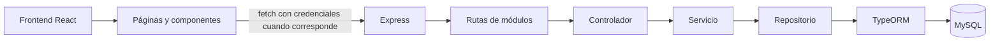

# Arquitectura

## Propósito

Este documento describe cómo se conectan las dos aplicaciones del repositorio: el frontend web y la API. El detalle de autenticación está en [Autenticación y permisos](autenticacion-y-permisos.md), y las entidades y relaciones están en [Base de datos](base-de-datos.md).

## Responsabilidades

El frontend, en `front-asiinet/asiinet/`, está hecho con React, JavaScript/JSX, React Router y Vite. Renderiza las pantallas, mantiene una copia pública del usuario en `sessionStorage` y llama a la API desde páginas y componentes. El calendario es la única integración agrupada en un servicio propio (`src/services/calendarService.js`); usuarios y tareas hacen sus solicitudes desde sus componentes.

El backend, en `back-asiinet/`, usa Node.js, TypeScript, Express, TypeORM y MySQL. `src/index.ts` configura Express y CORS, monta las rutas, inicializa la fuente de datos, prepara las cuentas iniciales y abre el servidor HTTP. La configuración de paquetes está separada: cada aplicación tiene su propio `package.json` y sus propios scripts.

## Cómo se conecta

El flujo routes → controller → service → repository → entity describe la organización habitual de los módulos; no todos los módulos tienen el mismo grado de validación o abstracción. Las rutas se montan con estos prefijos:

| Prefijo | Módulo |
| --- | --- |
| `/api/users` | Usuario y gestión de usuarios |
| `/api/tasks` | Tareas y solicitudes |
| `/api/events` | Eventos del calendario |
| `/api/brands` | Marcas |
| `/api/vehicle-models` | Modelos de vehículos |
| `/api/vehicles` | Vehículos |

`src/index.ts` instala CORS con credenciales y el parser JSON antes de las rutas. Las solicitudes que requieren sesión usan la cookie de autenticación; el contrato está detallado en [Autenticación y permisos](autenticacion-y-permisos.md). El frontend usa `VITE_API_URL` como base de API en las páginas y servicios que hacen solicitudes.

## Contratos de configuración

La tabla indica nombres y propósito según su uso en el código. No contiene valores de configuración.

| Variable | Propósito observado |
| --- | --- |
| `PORT` | Puerto de escucha HTTP del backend. |
| `DB_HOST`, `DB_PORT`, `DB_NAME`, `DB_USER`, `DB_PASS` | Parámetros de conexión MySQL que consume TypeORM. |
| `JWT_SECRET` | Secreto que el servicio de usuarios usa para firmar JWT y el middleware para verificarlos. |
| `NODE_ENV` | Afecta la opción `secure` de la cookie y las comprobaciones de configuración inicial en el arranque. |
| `INITIAL_ACCOUNTS_PASSWORD` | Contraseña usada al crear las cuentas iniciales; no se documentan valores. |
| `VITE_API_URL` | URL base que usa el frontend para construir solicitudes a la API. |

`SECRET_KEY` y `JWT_EXPIRES_IN` figuran en `back-asiinet/.env_example`; no se detectó uso de esos nombres en el código. La vigencia del JWT se define directamente en el servicio de login. El propósito efectivo de `SECRET_KEY` queda **No verificado**.

## Reglas de negocio

La arquitectura no agrega reglas de negocio propias. Las reglas de sesión, permisos y acceso a tareas/eventos están en [Autenticación y permisos](autenticacion-y-permisos.md); las reglas de persistencia declaradas están en [Base de datos](base-de-datos.md).

## Errores y limitaciones conocidas

Las rutas no encontradas pasan por `notFoundHandler`; los errores de aplicación y los errores inesperados pasan por `errorHandler`. La forma JSON común de `AppError` es `{ status, code, message }`; algunos controladores también responden directamente.

La fuente de datos declara `synchronize: true` y no hay configuración de migraciones en los scripts revisados. Las entidades describen el esquema esperado por TypeORM; el estado de una base de datos existente queda **No verificado**.

## Archivos fuente

- `back-asiinet/src/index.ts`
- `back-asiinet/src/database/data-source.ts`
- `back-asiinet/package.json`
- `back-asiinet/tsconfig.json`
- `back-asiinet/.env_example` (se leyeron solo los nombres de variables)
- `front-asiinet/asiinet/package.json`
- `front-asiinet/asiinet/vite.config.js`
- `front-asiinet/asiinet/index.html`
- `front-asiinet/asiinet/src/main.jsx`
- `front-asiinet/asiinet/src/App.jsx`
- `front-asiinet/asiinet/src/routes/AppRoutes.jsx`
- `front-asiinet/asiinet/src/pages/Login.jsx`
- `front-asiinet/asiinet/src/pages/Register.jsx`
- `front-asiinet/asiinet/src/services/calendarService.js`
- `front-asiinet/asiinet/src/pages/Profile.jsx`
- `front-asiinet/asiinet/src/pages/Users.jsx`
- `front-asiinet/asiinet/src/pages/Tareas.jsx`
- `front-asiinet/asiinet/src/pages/Calendar.jsx`
- `front-asiinet/asiinet/src/components/dashboard/AccountActions.jsx`
- `back-asiinet/src/middlewares/errors.ts`
