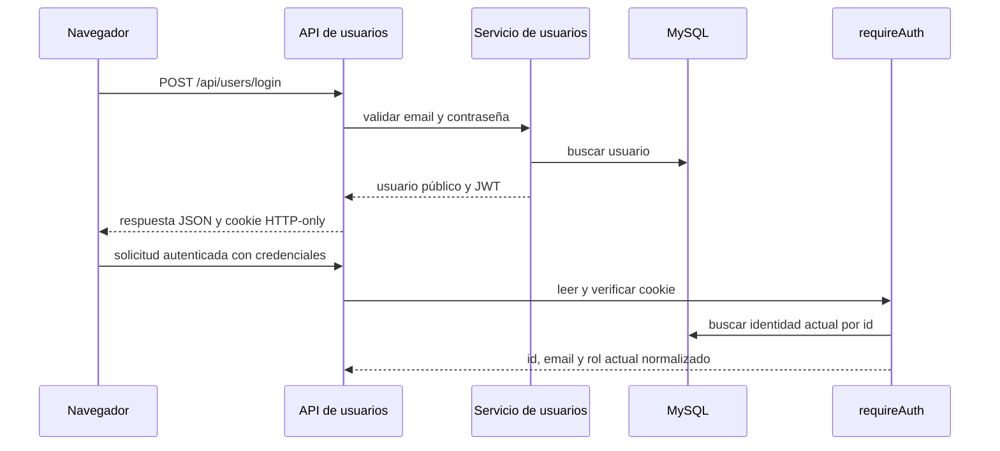

# Autenticación y permisos

## Propósito

Describe el inicio y cierre de sesión, la identidad que usa el backend en cada solicitud y los permisos que las rutas de usuarios, tareas y eventos aplican. La arquitectura general está en [Arquitectura](arquitectura.md); las entidades están en [Base de datos](base-de-datos.md).

## Responsabilidades

El controlador de usuarios recibe login y registro, el servicio de usuarios compara las credenciales y genera el JWT, y `requireAuth` valida la cookie y carga la identidad actual desde la base. `requirePermission`, `requireRole` y `requireTaskAccess` aplican permisos generales y restricciones por tarea.

## Cómo se conecta

El backend establece la cookie `token` con `httpOnly`, `sameSite: "lax"`, ruta `/` y duración de una hora. `secure` se activa cuando `NODE_ENV` es `production`; esto está en [`login`](../back-asiinet/src/modules/user/user.controller.ts#L16). El cuerpo del login también incluye los campos `token` y `user`; el frontend guarda solo `user` en `sessionStorage` y usa `credentials: "include"` para enviar la cookie. No se documenta ni reproduce ningún valor de token.

`requireAuth` verifica el JWT con `JWT_SECRET` y consulta la fila de usuario por el id verificado. El email y el rol asociados a la solicitud salen de esa fila actual; si el usuario ya no existe, la solicitud no se autentica. Esto está implementado en `createRequireAuth` de [`auth.ts`](../back-asiinet/src/middlewares/auth.ts#L139) y en `findById` de [`user.repository.ts`](../back-asiinet/src/modules/user/user.repository.ts).

El registro público fija el rol `cliente`, aunque el cuerpo mande otro valor; lo hace `createRegisterHandler` en [`user.controller.ts`](../back-asiinet/src/modules/user/user.controller.ts#L6). El cierre de sesión limpia la cookie desde [`logout`](../back-asiinet/src/modules/user/user.controller.ts#L32). En el frontend, `ProtectedRoute` comprueba el usuario almacenado localmente; las rutas protegidas del servidor vuelven a comprobar la sesión y los permisos.

## Contratos de acceso

| Ruta | Acceso declarado |
| --- | --- |
| `POST /api/users/register`, `POST /api/users/login`, `POST /api/users/logout` | Públicas. |
| `GET /api/users/me`, `PUT /api/users/me` | Sesión válida. |
| `GET /api/users/assignables` | Sesión válida y `users:read`. |
| `GET /api/users/admin-only` | Sesión válida y rol `admin`. |
| `GET`, `POST /api/users`; `PUT`, `DELETE /api/users/:id` | Sesión válida y `users:write`. Solo `admin` tiene ese permiso. |
| `GET /api/tasks` | Sesión válida y `tasks:read`; el servicio filtra la lista por rol. |
| `POST /api/tasks` | Sesión válida y `tasks:create`. |
| `PUT /api/tasks/:id` | Sesión válida, `tasks:update` y acceso a la tarea. |
| `DELETE /api/tasks/:id` | Sesión válida, `tasks:delete` y acceso a la tarea. |
| `GET /api/events` | Sesión válida y `calendar:read`. |
| `POST /api/events`, `PUT /api/events/:id`, `DELETE /api/events/:id` | Sesión válida y `calendar:write`; las dos últimas operaciones además requieren ser quien creó el evento. |
| `GET /api/vehicles`, `GET /api/brands`, `GET /api/vehicle-models` | Sesión válida y `vehicles:read`. |
| `POST`, `PUT`, `DELETE` en `/api/vehicles`, `/api/brands`, `/api/vehicle-models` | Sesión válida y `vehicles:write`. |

Las rutas y su middleware están declarados en [`user.routes.ts`](../back-asiinet/src/modules/user/user.routes.ts), [`task.routes.ts`](../back-asiinet/src/modules/task/task.routes.ts), [`event.routes.ts`](../back-asiinet/src/modules/event/event.routes.ts), [`vehicle.routes.ts`](../back-asiinet/src/modules/vehicle/vehicle.routes.ts), [`brand.routes.ts`](../back-asiinet/src/modules/brand/brand.routes.ts) y [`vehicle-model.routes.ts`](../back-asiinet/src/modules/vehicle-model/vehicle-model.routes.ts).

## Reglas de negocio

### Roles y permisos generales

`normalizeRole` convierte los alias `user` y `client` en `cliente`, y `empleado` y `employee` en `operador`. Los roles canónicos son `admin`, `supervisor`, `operador` y `cliente`. `admin` supera todas las comprobaciones mediante `hasPermission`; el resto usa la matriz `ROLE_PERMISSIONS` de [`auth.ts`](../back-asiinet/src/middlewares/auth.ts#L30).

| Rol | Usuarios | Tareas | Galería | Calendario | Vehículos |
| --- | --- | --- | --- | --- | --- |
| `admin` | Leer y escribir | Leer, crear, actualizar y eliminar | Leer | Leer y escribir | Leer y escribir |
| `supervisor` | Leer | Leer, crear y actualizar | Leer | Leer y escribir | Leer y escribir |
| `operador` | Sin permiso general | Leer, crear y actualizar | Leer | Leer y escribir | Solo leer |
| `cliente` | Leer | Leer, crear y actualizar | Leer | Sin permiso | Sin permiso |

El permiso `gallery:read` aparece en la matriz, pero no se encontró un router de galería montado en `index.ts`.

La matriz describe permisos generales. Para tareas se aplica también `canAccessTask` de [`auth.ts`](../back-asiinet/src/middlewares/auth.ts#L88): admin puede acceder a cualquier tarea; supervisor puede leer y actualizar, pero no eliminar; operador puede actualizar solo una tarea asignada a su `employeeId`; cliente lee y actualiza sus solicitudes y no las elimina. En la lista `GET /api/tasks`, `getAll` de [`task.service.ts`](../back-asiinet/src/modules/task/task.service.ts#L48) filtra al operador por `employeeId`. La función `canAccessTask` acepta, para la acción `read`, coincidencia con `employeeId` o `clientId`; no hay una ruta GET individual de tareas en `task.routes.ts`. Los esquemas por rol están en `parseTaskCreateInput` y `parseTaskUpdateInput` de [`task.controller.ts`](../back-asiinet/src/modules/task/task.controller.ts#L60).

Para eventos, tener `calendar:write` no habilita administrar eventos ajenos: `update` y `remove` de [`createEventService`](../back-asiinet/src/modules/event/event.service.ts#L39) comparan `creadorId` con el id del actor. La regla también se aplica a administradores.

## Errores y limitaciones conocidas

Los rechazos de autenticación y permisos se convierten en `401` o `403` mediante `AppError` y el manejador central. La forma común de esos errores se describe en [`errors.ts`](../back-asiinet/src/middlewares/errors.ts).

La protección de navegación del frontend usa el objeto de `sessionStorage`; la identidad y los permisos efectivos de la API dependen de la cookie y las comprobaciones del backend.

## Archivos fuente

- `back-asiinet/src/middlewares/auth.ts`
- `back-asiinet/src/middlewares/errors.ts`
- `back-asiinet/src/modules/user/user.routes.ts`
- `back-asiinet/src/modules/user/user.controller.ts`
- `back-asiinet/src/modules/user/user.service.ts`
- `back-asiinet/src/modules/user/user.repository.ts`
- `back-asiinet/src/modules/task/task.routes.ts`
- `back-asiinet/src/modules/task/task.controller.ts`
- `back-asiinet/src/modules/task/task.service.ts`
- `back-asiinet/src/modules/event/event.routes.ts`
- `back-asiinet/src/modules/event/event.service.ts`
- `front-asiinet/asiinet/src/routes/AppRoutes.jsx`
- `front-asiinet/asiinet/src/pages/Login.jsx`
- `front-asiinet/asiinet/src/pages/Register.jsx`
- `front-asiinet/asiinet/src/components/dashboard/AccountActions.jsx`
