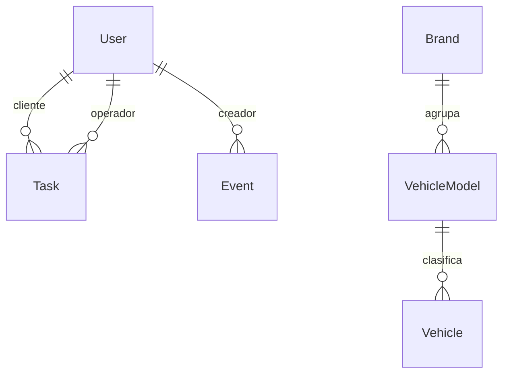

# Base de datos

## Propósito

Resume las entidades TypeORM, sus campos principales y las relaciones declaradas. Describe la configuración del esquema que se puede verificar en el código; no afirma el estado actual de una base ya creada.

## Responsabilidades

`AppDataSource` configura MySQL, registra las entidades y deja que TypeORM sincronice el esquema al inicializarse. Los repositorios de cada módulo consultan y guardan las entidades a través de esa fuente de datos.

## Cómo se conecta

Las relaciones de las tareas permiten que una cuenta sea cliente o empleado de varias tareas. Cada evento requiere un creador. Un modelo pertenece a una marca y un vehículo pertenece a un modelo.

## Entidades y contratos

| Entidad y tabla | Campos declarados | Relaciones y borrado |
| --- | --- | --- |
| `User` — `usuarios` | `id`, `nombre`, `email`, `passwordHash`, `role`, `fechaNacimiento`, `domicilio`, `fotoPerfil`, `creadoEn` | `email` es único. No declara relaciones salientes. |
| `Task` — `tareas` | `id`, `client`, `clientId`, `employee`, `employeeId`, `createdAt`, `dueDate`, `visitDate`, `visitTimeSlot`, `description`, `service`, `serviceDetails`, `priority`, `status` | `serviceDetails` usa `simple-json` nullable; `visitDate` (`date`) y `visitTimeSlot` (`varchar`) son nullable. `clientUser` y `employeeUser` son relaciones opcionales a `User`; ambas declaran `onDelete: SET NULL`. |
| `Event` — `eventos` | `id`, `titulo`, `tipo`, `fecha`, `descripcion`, `creadorId`, `creadoEn`, `actualizadoEn` | Relación requerida con `User`; declara `onDelete: CASCADE`. |
| `Brand` — `brands` | `id`, `descripcion` | `descripcion` es única. |
| `VehicleModel` — `vehicle_models` | `id`, `descripcion` | Relación `ManyToOne` a `Brand`, con columna `brand_id`; no declara una acción `onDelete`. |
| `Vehicle` — `vehicles` | `id`, `patente`, `color`, `descripcion`, `estado`, `employee_id` | `patente` es única. Relación `ManyToOne` a `VehicleModel`, con columna `vehicle_model_id`, sin acción `onDelete` declarada. `employee_id` es una columna escalar nullable, no una relación TypeORM. |

Los nombres de tablas, columnas y acciones salen de las entidades [`User`](../back-asiinet/src/modules/user/user.entity.ts#L4), [`Task`](../back-asiinet/src/modules/task/task.entity.ts#L11), [`Event`](../back-asiinet/src/modules/event/event.entity.ts#L12), [`Brand`](../back-asiinet/src/modules/brand/brand.entity.ts#L3), [`VehicleModel`](../back-asiinet/src/modules/vehicle-model/vehicle-model.entity.ts#L4) y [`Vehicle`](../back-asiinet/src/modules/vehicle/vehicle.entity.ts#L4). `simple-json` serializa el objeto como texto JSON y no usa JSON nativo del motor, por lo que es portable entre MySQL y MariaDB.

## Reglas de negocio

En el esquema declarado, `User.email`, `Brand.descripcion` y `Vehicle.patente` son únicos. Las relaciones de tareas y eventos tienen las acciones de borrado indicadas en la tabla. Las entidades de vehículo no declaran una acción de borrado explícita; no se infiere una regla adicional.

## Reglas de esquema

`AppDataSource` en [`data-source.ts`](../back-asiinet/src/database/data-source.ts#L11) usa el driver MySQL, toma sus parámetros de `DB_HOST`, `DB_PORT`, `DB_USER`, `DB_PASS` y `DB_NAME`, registra las entidades y establece `synchronize: true`. TypeORM agregará `visitDate` y `visitTimeSlot` como columnas nullable en `tareas`; las filas existentes quedarán sin visita (`NULL`), sin backfill ni actualización de datos. No se encontró configuración de migraciones TypeORM en el backend. El SQL concreto, la versión del motor y el estado de una base particular no fueron verificados.

Las acciones explícitas al borrar son `SET NULL` para las dos relaciones de tareas a usuarios y `CASCADE` para el creador de eventos. Para las relaciones de modelo a marca y vehículo a modelo, la entidad no declara una acción `onDelete`; el efecto concreto queda **No verificado**.

## Errores y limitaciones conocidas

No se consultó ni modificó una base de datos. El esquema existente, los datos, las restricciones que ya estén aplicadas y el resultado de `synchronize` en un entorno concreto quedan **No verificado**. La documentación describe únicamente las declaraciones TypeORM leídas.

## Archivos fuente

- `back-asiinet/src/database/data-source.ts`
- `back-asiinet/src/modules/user/user.entity.ts`
- `back-asiinet/src/modules/task/task.entity.ts`
- `back-asiinet/src/modules/event/event.entity.ts`
- `back-asiinet/src/modules/brand/brand.entity.ts`
- `back-asiinet/src/modules/vehicle-model/vehicle-model.entity.ts`
- `back-asiinet/src/modules/vehicle/vehicle.entity.ts`
